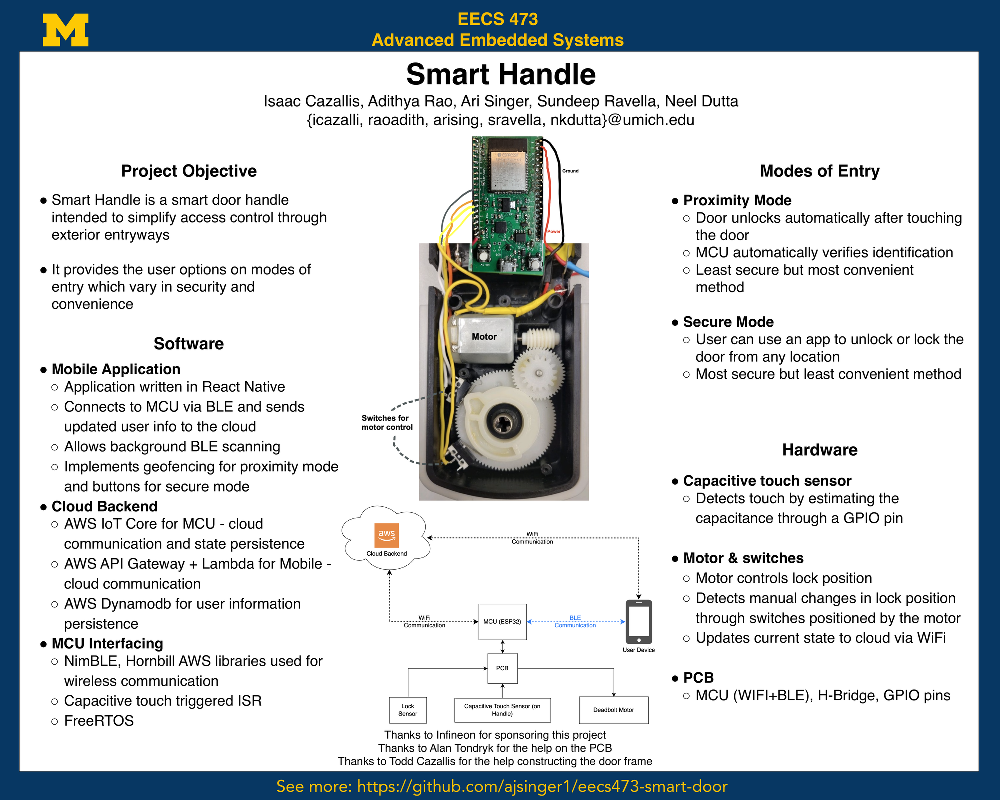

# Smart Handle 🚪

**A door handle that knows who you are.**

Walk up, touch the handle, and the deadbolt turns — no keys, no fumbling for your phone.
Or, if you'd rather be careful about it, lock and unlock from anywhere in the world with a tap.

Smart Handle was our final project for **EECS 473: Advanced Embedded Systems** at the
University of Michigan. It's a full stack in miniature: an ESP32 driving a motorized
deadbolt, a React Native app talking over BLE, and an AWS backend keeping everyone in sync.



<sub>📄 [Download the poster as a PDF](docs/EECS473-Smart-Handle-Poster.pdf)</sub>


## Two ways in

| | **Proximity Mode** | **Secure Mode** |
|---|---|---|
| How it works | Touch the handle; the MCU verifies you're nearby and unlocks | Press unlock in the app, from anywhere |
| Trade-off | Most convenient, least secure | Most secure, least convenient |
| Tech | Capacitive touch → ISR → BLE identity check + geofence | App → API Gateway → Lambda → IoT Core → MCU |

## How it fits together

```
   📱 Phone  ──BLE──►  ESP32  ──WiFi──►  AWS IoT Core ──► DynamoDB
      │                  │                    ▲
      └──────WiFi────────┼────────────────────┘
                         │              (API Gateway + Lambda)
                    PCB ─┼─ capacitive touch sensor
                         ├─ H-bridge → deadbolt motor
                         └─ lock-position switches
```

The switches by the motor mean the handle notices when someone turns the bolt by hand,
so the cloud state never drifts from reality.

## What's in this repo

| Directory | What lives there |
|---|---|
| [`mcu/`](mcu) | ESP32 firmware — FreeRTOS, NimBLE, capacitive touch ISR, motor control |
| [`cloud/`](cloud) | AWS Lambda handlers behind API Gateway, IoT device shadow, DynamoDB |
| [`mobile/`](mobile) | React Native app — background BLE scanning + geofencing *(git submodule)* |
| [`prototype_sketches/`](prototype_sketches) | The messy, wonderful road here: BLE, motor, touch, and mbed experiments |

Cloning the app too? `git clone --recurse-submodules`, or `git submodule update --init`
if you're already here.

## Hardware

- **ESP32** (WiFi + BLE) on a custom PCB with an H-bridge for the motor
- **Capacitive touch sensor** in the handle, read by estimating capacitance on a GPIO pin
- **DC motor + gear train** driving a standard deadbolt
- **Lock-position switches** to detect manual turns

## Authors

Isaac Cazallis · Neel Dutta · Adithya Rao · Sundeep Ravella · Ari Singer

*Thanks to Infineon for sponsoring the project, Alan Tondryk for help with the PCB,
and Todd Cazallis for building the door frame.*
